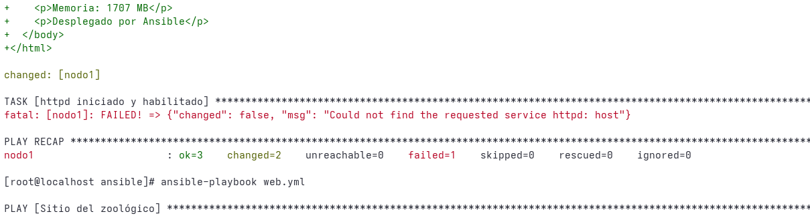
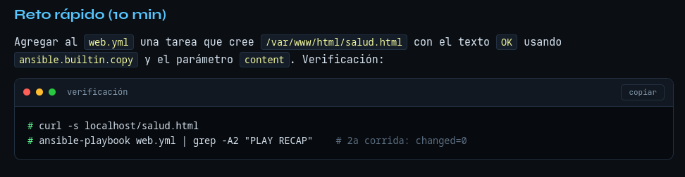

## Parte 3 Playbooks de ansible

### Playbook 1 - Usuarios con loop

Creamos el archivo **usuarios.yml** en la carpeta de trabajo /root/devops2026/ansible

```shellsession
[root@localhost ansible]# pwd
/root/devops2026/ansible
[root@localhost ansible]# touch usuarios.yml
[root@localhost ansible]# vim usuarios.yml
```

con el siguiente contenido

```yml
---
- name: Cuidadores del zoológico
  hosts: web
  become: true
  vars:
    cuidadores:
      - koala
      - panda
      - lince
  tasks:
    - name: Crear grupo cuidadores
      ansible.builtin.group:
        name: cuidadores
        state: present

    - name: Crear usuarios
      ansible.builtin.user:
        name: "{{ item }}"
        groups: cuidadores
        append: true
        shell: /bin/bash
      loop: "{{ cuidadores }}"

    - name: Directorio compartido
      ansible.builtin.file:
        path: /opt/zoologico
        state: directory
        group: cuidadores
        mode: "2770"
```

Pasamos a usar el playbook

```shellsession
[root@localhost ansible]# ansible-playbook usuarios.yml --syntax-check

playbook: usuarios.yml
[root@localhost ansible]# ansible-playbook usuarios.yml

PLAY [Cuidadores del zoológico] ************************************************************************************************************************************************************************************

TASK [Gathering Facts] *********************************************************************************************************************************************************************************************
ok: [nodo1]

TASK [Crear grupo cuidadores] **************************************************************************************************************************************************************************************
ok: [nodo1]

TASK [Crear usuarios] **********************************************************************************************************************************************************************************************
changed: [nodo1] => (item=koala)
ok: [nodo1] => (item=panda)
ok: [nodo1] => (item=lince)

TASK [Directorio compartido] ***************************************************************************************************************************************************************************************
changed: [nodo1]

PLAY RECAP *********************************************************************************************************************************************************************************************************
nodo1                      : ok=4    changed=2    unreachable=0    failed=0    skipped=0    rescued=0    ignored=0   

[root@localhost ansible]# ansible-playbook usuarios.yml

PLAY [Cuidadores del zoológico] ************************************************************************************************************************************************************************************

TASK [Gathering Facts] *********************************************************************************************************************************************************************************************
ok: [nodo1]

TASK [Crear grupo cuidadores] **************************************************************************************************************************************************************************************
ok: [nodo1]

TASK [Crear usuarios] **********************************************************************************************************************************************************************************************
ok: [nodo1] => (item=koala)
ok: [nodo1] => (item=panda)
ok: [nodo1] => (item=lince)

TASK [Directorio compartido] ***************************************************************************************************************************************************************************************
ok: [nodo1]

PLAY RECAP *********************************************************************************************************************************************************************************************************
nodo1                      : ok=4    changed=0    unreachable=0    failed=0    skipped=0    rescued=0    ignored=0   

[root@localhost ansible]# id panda; ls -ld /opt/zoologico
uid=8003(panda) gid=8004(panda) grupos=8004(panda),8002(cuidadores)
drwxrws---. 2 root cuidadores 6 oct 23 09:40 /opt/zoologico
[root@localhost ansible]# 
```

ha funcionado y se ha podido ejecutar dos veces con confianza, ya que es idempotente

### Playbook 2 - Servidor web con template handler

Para este don dos archivos **web.yml** y  **index.html.j2**

Se crea los archivos en la carpeta de trabajo

```shellsession
[root@localhost ansible]# touch web.yml
[root@localhost ansible]# touch index.html.j2
[root@localhost ansible]# vim web.yml 
[root@localhost ansible]# vim index.html.j2 
```

Con su respectivo contendido

web.yml

```yml
---
- name: Sitio del zoológico
  hosts: web
  become: true
  vars:
    titulo: "Zoológico DevOps 2026"
  tasks:
    - name: Instalar httpd
      ansible.builtin.dnf:
        name: httpd
        state: present

    - name: Publicar index.html desde plantilla
      ansible.builtin.template:
        src: index.html.j2
        dest: /var/www/html/index.html
        owner: root
        group: root
        mode: "0644"
      notify: Reiniciar httpd

    - name: httpd iniciado y habilitado
      ansible.builtin.service:
        name: httpd
        state: started
        enabled: true

  handlers:
    - name: Reiniciar httpd
      ansible.builtin.service:
        name: httpd
        state: restarted
```

index.html.j2

```html
<html>
  <body style="font-family:monospace;background:#111;color:#5af78e">
    <h1>{{ titulo }}</h1>
    <p>Servidor: {{ ansible_facts['hostname'] }}</p>
    <p>SO: {{ ansible_facts['distribution'] }} {{ ansible_facts['distribution_version'] }}</p>
    <p>Memoria: {{ ansible_facts['memtotal_mb'] }} MB</p>
    <p>Desplegado por Ansible</p>
  </body>
</html>
```

Pasamos a la ejecución del playbook

```shellsession
[root@localhost ansible]# ansible-playbook web.yml --check --diff 

PLAY [Sitio del zoológico] *****************************************************************************************************************************************************************************************

TASK [Gathering Facts] *********************************************************************************************************************************************************************************************
ok: [nodo1]

TASK [Instalar httpd] **********************************************************************************************************************************************************************************************
changed: [nodo1]

TASK [Publicar index.html desde plantilla] *************************************************************************************************************************************************************************
--- before
+++ after: /root/.ansible/tmp/ansible-local-1090302izsux4/tmpb_4aa0ah/index.html.j2
@@ -0,0 +1,9 @@
+<html>
+  <body style="font-family:monospace;background:#111;color:#5af78e">
+    <h1>Zoológico DevOps 2026</h1>
+    <p>Servidor: localhost</p>
+    <p>SO: Rocky 9.8</p>
+    <p>Memoria: 1707 MB</p>
+    <p>Desplegado por Ansible</p>
+  </body>
+</html>

changed: [nodo1]

TASK [httpd iniciado y habilitado] *********************************************************************************************************************************************************************************
fatal: [nodo1]: FAILED! => {"changed": false, "msg": "Could not find the requested service httpd: host"}

PLAY RECAP *********************************************************************************************************************************************************************************************************
nodo1                      : ok=3    changed=2    unreachable=0    failed=1    skipped=0    rescued=0    ignored=0   

[root@localhost ansible]# 
```

Salen colores rojos, pero nada que temer. está comprobando lo que debeŕia hacer la simulación de la ejecucion del playbook



La siguiente ejecución sin simulación si será limpia.

```shellsession
[root@localhost ansible]# ansible-playbook web.yml

PLAY [Sitio del zoológico] *****************************************************************************************************************************************************************************************

TASK [Gathering Facts] *********************************************************************************************************************************************************************************************
ok: [nodo1]

TASK [Instalar httpd] **********************************************************************************************************************************************************************************************
changed: [nodo1]

TASK [Publicar index.html desde plantilla] *************************************************************************************************************************************************************************
changed: [nodo1]

TASK [httpd iniciado y habilitado] *********************************************************************************************************************************************************************************
changed: [nodo1]

RUNNING HANDLER [Reiniciar httpd] **********************************************************************************************************************************************************************************
changed: [nodo1]

PLAY RECAP *********************************************************************************************************************************************************************************************************
nodo1                      : ok=5    changed=4    unreachable=0    failed=0    skipped=0    rescued=0    ignored=0   

[root@localhost ansible]# 
```

curl si nos responde con el html

```shellsession
[root@localhost ansible]# curl -s localhost
<html>
  <body style="font-family:monospace;background:#111;color:#5af78e">
    <h1>Zoológico DevOps 2026</h1>
    <p>Servidor: localhost</p>
    <p>SO: Rocky 9.8</p>
    <p>Memoria: 1707 MB</p>
    <p>Desplegado por Ansible</p>
  </body>
</html>
[root@localhost ansible]# 
```

Que ansible modifique el html 

```shellsession
[root@localhost ansible]# ansible-playbook web.yml 

PLAY [Sitio del zoológico] *****************************************************************************************************************************************************************************************

TASK [Gathering Facts] *********************************************************************************************************************************************************************************************
ok: [nodo1]

TASK [Instalar httpd] **********************************************************************************************************************************************************************************************
ok: [nodo1]

TASK [Publicar index.html desde plantilla] *************************************************************************************************************************************************************************
ok: [nodo1]

TASK [httpd iniciado y habilitado] *********************************************************************************************************************************************************************************
ok: [nodo1]

PLAY RECAP *********************************************************************************************************************************************************************************************************
nodo1                      : ok=4    changed=0    unreachable=0    failed=0    skipped=0    rescued=0    ignored=0   

[root@localhost ansible]# ansible-playbook web.yml -e "titulo='Zoológico - turno vespertino'" --diff

PLAY [Sitio del zoológico] *****************************************************************************************************************************************************************************************

TASK [Gathering Facts] *********************************************************************************************************************************************************************************************
ok: [nodo1]

TASK [Instalar httpd] **********************************************************************************************************************************************************************************************
ok: [nodo1]

TASK [Publicar index.html desde plantilla] *************************************************************************************************************************************************************************
--- before: /var/www/html/index.html
+++ after: /root/.ansible/tmp/ansible-local-145735vmdc2r6/tmphi0xewoc/index.html.j2
@@ -1,6 +1,6 @@
 <html>
   <body style="font-family:monospace;background:#111;color:#5af78e">
-    <h1>Zoológico DevOps 2026</h1>
+    <h1>Zoológico - turno vespertino</h1>
     <p>Servidor: localhost</p>
     <p>SO: Rocky 9.8</p>
     <p>Memoria: 1707 MB</p>

changed: [nodo1]

TASK [httpd iniciado y habilitado] *********************************************************************************************************************************************************************************
ok: [nodo1]

RUNNING HANDLER [Reiniciar httpd] **********************************************************************************************************************************************************************************
changed: [nodo1]

PLAY RECAP *********************************************************************************************************************************************************************************************************
nodo1                      : ok=5    changed=2    unreachable=0    failed=0    skipped=0    rescued=0    ignored=0   

[root@localhost ansible]# 
```

efectivamente lo modifico

```shellsession
[root@localhost ansible]#  curl -s localhost
<html>
  <body style="font-family:monospace;background:#111;color:#5af78e">
    <h1>Zoológico - turno vespertino</h1>
    <p>Servidor: localhost</p>
    <p>SO: Rocky 9.8</p>
    <p>Memoria: 1707 MB</p>
    <p>Desplegado por Ansible</p>
  </body>
</html>
[root@localhost ansible]# 
```

ahora dice zoologico turno vespertino y no desplegado por ansile

#### Reto de 10 minutos



se crea el archivo **web-salud.yml** en el directorio de trabajo

```shellsession
[root@localhost ansible]# touch web-salud.yml
[root@localhost ansible]# vim web-salud.yml 
```

que hace las mismas tareas que **web.yml** original mas la solicitada en el reto

web-salud.yml

```yml
---
- name: Sitio del zoológico
  hosts: web
  become: true
  vars:
    titulo: "Zoológico DevOps 2026"
  tasks:
    - name: Instalar httpd
      ansible.builtin.dnf:
        name: httpd
        state: present

    - name: Publicar index.html desde plantilla
      ansible.builtin.template:
        src: index.html.j2
        dest: /var/www/html/index.html
        owner: root
        group: root
        mode: "0644"
      notify: Reiniciar httpd

    - name: Crear archivo de salud
      ansible.builtin.copy:
        content: "OK\n"
        dest: /var/www/html/salud.html
        owner: root
        group: root
        mode: "0644"

    - name: httpd iniciado y habilitado
      ansible.builtin.service:
        name: httpd
        state: started
        enabled: true

  handlers:
    - name: Reiniciar httpd
      ansible.builtin.service:
        name: httpd
        state: restarted
```

Ejecutamos este nuevo playbook

```shellsession
[root@localhost ansible]# ansible-playbook web-salud.yml 

PLAY [Sitio del zoológico] *****************************************************************************************************************************************************************************************

TASK [Gathering Facts] *********************************************************************************************************************************************************************************************
ok: [nodo1]

TASK [Instalar httpd] **********************************************************************************************************************************************************************************************
ok: [nodo1]

TASK [Publicar index.html desde plantilla] *************************************************************************************************************************************************************************
changed: [nodo1]

TASK [Crear archivo de salud] **************************************************************************************************************************************************************************************
changed: [nodo1]

TASK [httpd iniciado y habilitado] *********************************************************************************************************************************************************************************
ok: [nodo1]

RUNNING HANDLER [Reiniciar httpd] **********************************************************************************************************************************************************************************
changed: [nodo1]

PLAY RECAP *********************************************************************************************************************************************************************************************************
nodo1                      : ok=6    changed=3    unreachable=0    failed=0    skipped=0    rescued=0    ignored=0   

[root@localhost ansible]# 
```

Y probamos: curl responde [OK]

```shellsession
[root@localhost ansible]# curl -s localhost/salud.html
OK
```

y el recap del playbook

```shellsession
[root@localhost ansible]# ansible-playbook web-salud.yml | grep -A2 "PLAY RECAP"
PLAY RECAP *********************************************************************
nodo1                      : ok=5    changed=0    unreachable=0    failed=0    skipped=0    rescued=0    ignored=0   

[root@localhost ansible]# 
```
